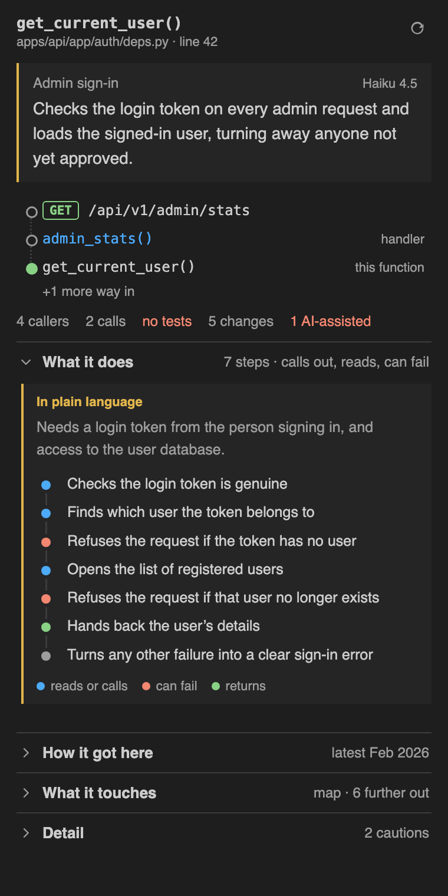

<h1 align="center">Code Context Lens</h1>
<p align="center"><b>Know what you're touching.</b></p>
<p align="center">
  <a href="https://marketplace.visualstudio.com/items?itemName=dhanyaaleena.code-context-lens"></a>
</p>

Put your cursor in a function you didn't write. Code Context tells you what it does in
plain language, how people and systems reach it, why it was built, and what it's connected to —
in a panel beside your code.

<table>
<tr>
<td width="50%"></td>
<td width="50%"></td>
</tr>
</table>

## Reading the panel

**The summary.** The product area the function belongs to, and one sentence on what it does, in words
anyone on the team can follow. The amber bar on the left means an AI wrote it; the model that answered
is named on the right.

**The journey.** How the outside world gets here: the route or job, the handler it lands in, then this
function. Routes carry a method badge — `GET`, `POST`, `DELETE` — and every row is a click to that code.
It reads your framework's routing — for Python: FastAPI, Flask, Celery, APScheduler, Click, Typer and
Django signals; for Go: net/http, Gin, Echo, Chi, Gorilla mux, Fiber, Cobra, cron jobs, gRPC and `main()`.
Helpers that nothing reaches from outside simply don't get a journey.

**The numbers.** Callers, calls, tests, changes and AI-assisted commits, in one line. "No tests" is
flagged in red.

Then four sections, collapsed until you want them. Each remembers whether you left it open.

- **What it does** — a flowchart of the function in plain words — "If a vector has text, adds it to the
  results" rather than the code's `if`s and loops. Every way it can fail branches off in red
  (`✕ 404 · No such user`), and early returns in grey. With AI on, related steps are grouped into a handful of stages, each one
  sentence, so a long function still reads at a glance — **Break it down** shows every step again; without it, long lists fold after the first few
  steps. A box's coloured edge means *reads or calls*, *changes data* or *returns*; logging is left out.
  Click a box to jump to its code; hover to see the steps inside it.
- **How it got here** — why the function was built, from the commit that first introduced it, and how
  that has changed since. When no commit gave a reason, it's marked *inferred*. Below it, the commit
  history as a timeline, with the introducing commit marked *added here* — click any commit to see its diff.
- **What it touches** — a small map: callers above, this function in the middle, what it calls below.
  Click any box to go there. Links the analysis can't prove are drawn dashed.
- **Detail** — what would break if this failed, cautions worth knowing before you change it, whether
  tests reference it, who wrote it — each author's share of the current lines and how many changes they
  made — the commit the answer reflects, and which evidence the AI relied on. Author names stay on your
  machine; they are never sent to the AI.

Everything outside the amber bars — the journey, the steps' order, callers, commits — is computed
locally from your code and Git, and doesn't depend on a model.

## Getting started

1. Install **Code Context Lens** from the Extensions view — search for `code-context-lens` — and open a Python
   or Go project that uses Git. Or from a terminal:

   ```bash
   code --install-extension dhanyaaleena.code-context-lens      # VS Code
   cursor --install-extension dhanyaaleena.code-context-lens    # Cursor
   ```

2. Click the lens above any function — `3 callers · 5 calls — Show context` — or run
   **Code Context: Show context panel** from the command palette.

That's it for the computed view. Nothing leaves your machine.

### Optional: turn on AI descriptions

Everything above works without AI. To add the plain-language descriptions, click **Set up AI** at the
top of the panel — it's there until AI is set up. Three quick choices follow:

1. **Provider** — Anthropic, Google, OpenAI or xAI.
2. **Model** — the cheapest is listed first and marked *Recommended*; it's plenty for plain-language
   descriptions.
3. **Key** — paste it. If one is already saved, leave the box empty to keep it.

That's all — it turns AI descriptions on and saves your choice to `codeContext.ai.enabled` and
`codeContext.ai.model`.

Prefer the keyboard? The same steps run from <kbd>⇧⌘P</kbd> (<kbd>Ctrl+Shift+P</kbd> on Windows/Linux) →
**Code Context: Set API key** — which is also how to switch model or provider later.

| Provider | Recommended (cheapest) | Also offered | Where keys come from |
|---|---|---|---|
| **Anthropic** (Claude) | `claude-haiku-4-5` | `claude-sonnet-5`, `claude-opus-5` | **console.anthropic.com** → API keys. Create the key inside a *workspace*, not at organisation level, or requests are rejected. |
| **Google** (Gemini) | `gemini-2.5-flash` | `gemini-3.5-flash`, `gemini-3.6-flash`, `gemini-flash-latest` | **aistudio.google.com** → Get API key (starts with `AIza`) |
| **OpenAI** (GPT) | `gpt-6-luna` | `gpt-6-sol`, `gpt-6-astra` | **platform.openai.com** → API keys |
| **xAI** (Grok) | `grok-build-0.1` | `grok-4.7` | **console.x.ai** → API keys |

You can also edit `"codeContext.ai.model"` in **Preferences: Open User Settings (JSON)**. **GitHub Copilot** (VS Code only) needs no key: set it to `"vscode-lm"` and
`"codeContext.ai.enabled"` to `true`, then approve the consent prompt the first time.

Open the panel on any function and the description appears within a few seconds.

A description typically costs well under a cent on Haiku, and each function is only paid for once
until its code changes. Keys live in the editor's secret storage, never in settings or the repository.

**What is sent when it's on:** for the function you open — its first 80 lines, its routes, caller and
callee names with file paths, commit messages, and co-changed file names. Nothing else, and only to
the provider you chose.

## When the code changes

If you — or Cursor's agent, or Claude Code — edit the function, the panel says
*"This function changed since it was analysed"* and waits. It never re-analyses behind your back,
so an agent writing code in bursts doesn't bill you for descriptions of half-written functions.
Click **Re-analyse** when you're ready.

## Commands

| Command | |
|---|---|
| Show context panel | Open the panel for the function at the cursor |
| Re-analyse this function | Rebuild and ask the AI again |
| Set API key | Choose a provider and model and store its key — also turns AI on |
| List editor models | What your editor offers extensions (e.g. Copilot) |
| Clear AI narration cache | Forget saved descriptions |
| Re-index workspace | Rebuild the index from scratch |

## Settings

| Setting | Default | What it does |
|---|---|---|
| `codeContext.ai.enabled` | `false` | Turns on AI descriptions. Nothing leaves your machine until this is `true`. |
| `codeContext.ai.model` | `claude-haiku-4-5` | Which model writes them. The prefix picks the provider: `claude-*` Anthropic, `gemini-*` Google, `gpt-*` OpenAI, `grok-*` xAI, `vscode-lm` your editor's models. |
| `codeContext.ai.editorModel` | *(empty)* | Only with `vscode-lm`: prefer a model by name, e.g. `haiku` or `gpt-4.1`. |
| `codeContext.codeLens` | `true` | Show the lens above each function. |
| `codeContext.maxFiles` | `400` | How many source files to index for the name-matching fallback. |

## Good to know

- **Languages.** Python and Go get everything: steps, the journey, callers and history. Any other
  language your editor has a language server for — TypeScript, Rust, Java, C#… — gets the summary,
  callers, calls, the map and history, but not steps or the journey yet.
- **Callers come from your language server when there is one** — Pylance, gopls, and so on — so they
  understand types and are confirmed. Without one, the extension matches names instead, and marks what it
  can't prove as a guess. Detail shows which was used. For Go, installing the Go extension (which brings
  gopls) makes a real difference.
- **Nothing is ever labelled unused.** Calls made dynamically — `getattr`, registries, reflection — can
  be invisible to both methods.
- **Claude Pro/Max and Cursor subscriptions can't be used** for the AI layer — neither gives extensions
  access to its models.

## Documentation

- [User manual (PDF)](../docs/Code_Context_User_Manual.pdf) — setup, reading the panel, a worked example, troubleshooting
- [Architecture (PDF)](../docs/Code_Context_Architecture.pdf) — how it works and why it's built this way
- [Developing Code Context](../docs/DEVELOPMENT.md) — building, running and packaging from source

## License

[MIT](../LICENSE)
