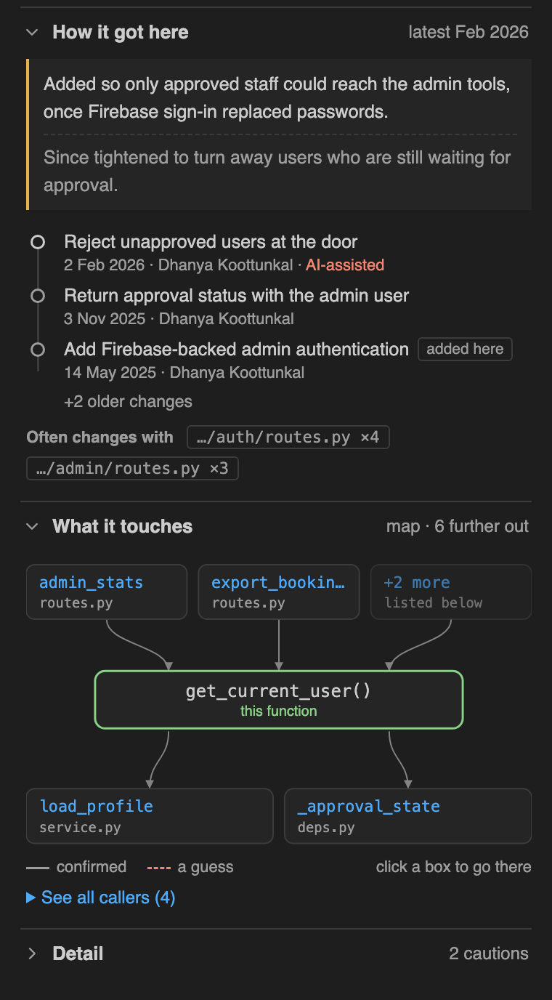

<h1 align="center">Code Context Lens</h1>
<p align="center"><b>Know what you're touching.</b></p>
<p align="center">
  <a href="https://marketplace.visualstudio.com/items?itemName=dhanyaaleena.code-context-lens"></a>
</p>

Put your cursor in a Python function you didn't write. Code Context tells you what it does in
plain language, how people and systems reach it, why it was built, and what it's connected to —
in a panel beside your code.

<table>
<tr>
<td width="50%"></td>
<td width="50%"></td>
</tr>
</table>

## Reading the panel

**The summary.** The product area the function belongs to, and one sentence on what it does, in words
anyone on the team can follow. The amber bar on the left means an AI wrote it; the model that answered
is named on the right.

**The journey.** How the outside world gets here: the route or job, the handler it lands in, then this
function. Routes carry a method badge — `GET`, `POST`, `DELETE` — and every row is a click to that code.
It reads your framework's routing: FastAPI, Flask, Celery, APScheduler, Click, Typer and Django signals.
Helpers that nothing reaches from outside simply don't get a journey.

**The numbers.** Callers, calls, tests, changes and AI-assisted commits, in one line. "No tests" is
flagged in red.

Then four sections, collapsed until you want them. Each remembers whether you left it open.

- **What it does** — the function's steps as a timeline, read from its body and put into plain words.
  The dot colours mean *reads or calls*, *changes data*, *can fail* and *returns*, with a key underneath.
  Click a step to jump to that line.
- **How it got here** — why the function was built, from the commit that first introduced it, and how
  that has changed since. When no commit gave a reason, it's marked *inferred*. Below it, the commit
  history as a timeline, with the introducing commit marked *added here* — click any commit to see its diff.
- **What it touches** — a small map: callers above, this function in the middle, what it calls below.
  Click any box to go there. Links the analysis can't prove are drawn dashed.
- **Detail** — what would break if this failed, cautions worth knowing before you change it, whether
  tests reference it, the commit the answer reflects, and which evidence the AI relied on.

Everything outside the amber bars — the journey, the steps' order, callers, commits — is computed
locally from your code and Git, and doesn't depend on a model.

## Getting started

1. Install **Code Context Lens** from the Extensions view (search "Code Context Lens") and open a Python project that uses Git.
2. Click the lens above any function — `3 callers · 5 calls — Show context` — or run
   **Code Context: Show context panel** from the command palette.

That's it for the computed view. Nothing leaves your machine.

### Optional: turn on AI descriptions

Everything above works without AI. To add the plain-language descriptions, do three things.

**1. Open your settings file.** Press <kbd>⇧⌘P</kbd> (<kbd>Ctrl+Shift+P</kbd> on Windows/Linux) and run
**Preferences: Open User Settings (JSON)**.

**2. Paste these two lines** inside the outer `{ }`:

```json
"codeContext.ai.enabled": true,
"codeContext.ai.model": "claude-haiku-4-5"
```

`claude-haiku-4-5` is only an example — it's the default, from Anthropic. Use whichever provider you have
access to:

| If you use | Set `codeContext.ai.model` to | What you need |
|---|---|---|
| **Anthropic** (Claude) | `claude-haiku-4-5` — cheapest, the default · or `claude-sonnet-5`, `claude-opus-5` | An Anthropic API key |
| **Google** (Gemini) | `gemini-3.6-flash` · or `gemini-3.5-flash`, `gemini-2.5-flash` | A Google AI Studio key (starts with `AIza`) |
| **OpenAI** (GPT) | `gpt-6-luna` — cheapest · or `gpt-6-sol`, `gpt-6-astra` | An OpenAI API key |
| **xAI** (Grok) | `grok-4.7` · or `grok-build-0.1` | An xAI API key |
| **GitHub Copilot** (VS Code only) | `vscode-lm` | No key — approve the consent prompt the first time |

If VS Code underlines something in red, a comma is usually missing on the line above.

**3. Add your API key** (skip this for Copilot). Run **Code Context: Set API key** from the command
palette, choose the provider, and paste the key.

- Anthropic keys come from **console.anthropic.com** → API keys. Create the key inside a *workspace*,
  not at organisation level, or requests are rejected.
- Google keys come from **aistudio.google.com** → Get API key.
- OpenAI keys come from **platform.openai.com** → API keys.
- xAI keys come from **console.x.ai** → API keys.

Open the panel on any function and the description appears within a few seconds.

A description typically costs well under a cent on Haiku, and each function is only paid for once
until its code changes. Keys live in the editor's secret storage, never in settings or the repository.

**What is sent when it's on:** for the function you open — its first 80 lines, its routes, caller and
callee names with file paths, commit messages, and co-changed file names. Nothing else, and only to
the provider you chose.

## When the code changes

If you — or Cursor's agent, or Claude Code — edit the function, the panel says
*"This function changed since it was analysed"* and waits. It never re-analyses behind your back,
so an agent writing code in bursts doesn't bill you for descriptions of half-written functions.
Click **Re-analyse** when you're ready.

## Commands

| Command | |
|---|---|
| Show context panel | Open the panel for the function at the cursor |
| Re-analyse this function | Rebuild and ask the AI again |
| Set API key | Store an Anthropic, Google, OpenAI or xAI key |
| List editor models | What your editor offers extensions (e.g. Copilot) |
| Clear AI narration cache | Forget saved descriptions |
| Re-index workspace | Rebuild the index from scratch |

## Settings

| Setting | Default | What it does |
|---|---|---|
| `codeContext.ai.enabled` | `false` | Turns on AI descriptions. Nothing leaves your machine until this is `true`. |
| `codeContext.ai.model` | `claude-haiku-4-5` | Which model writes them. The prefix picks the provider: `claude-*` Anthropic, `gemini-*` Google, `gpt-*` OpenAI, `grok-*` xAI, `vscode-lm` your editor's models. |
| `codeContext.ai.editorModel` | *(empty)* | Only with `vscode-lm`: prefer a model by name, e.g. `haiku` or `gpt-4.1`. |
| `codeContext.codeLens` | `true` | Show the lens above each function. |
| `codeContext.maxFiles` | `400` | How many Python files to index. |

## Good to know

- **Python only**, for now.
- **Caller detection reads names, not types.** Calls made through `getattr`, registries or dispatch
  tables can be missed, so the extension never labels code as unused.
- **Claude Pro/Max and Cursor subscriptions can't be used** for the AI layer — neither gives extensions
  access to its models.

## Documentation

- [User manual (PDF)](../docs/Code_Context_User_Manual.pdf) — setup, reading the panel, a worked example, troubleshooting
- [Architecture (PDF)](../docs/Code_Context_Architecture.pdf) — how it works and why it's built this way
- [Developing Code Context](../docs/DEVELOPMENT.md) — building, running and packaging from source

## License

[MIT](../LICENSE)
