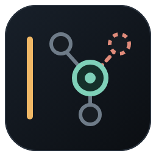
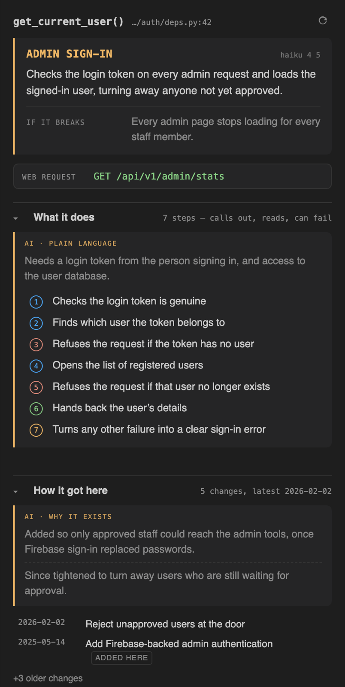

<p align="center"></p>

<h1 align="center">Code Context</h1>
<p align="center"><b>Know what you're touching.</b></p>

Put your cursor in a Python function you didn't write. Code Context tells you what it does in
plain language, how people and systems reach it, why it was built, and what breaks if you change it —
in a panel beside your code.

<p align="center"></p>

## What you get

- **The feature it belongs to**, in product words, with a one-line summary and who notices if it breaks.
- **How the outside world reaches it** — the URL, scheduled job, CLI command or event that ends up here,
  read from your framework's routing (FastAPI, Flask, Celery, APScheduler, Click, Typer, Django signals).
- **What it does, step by step** — read from the function body, numbered, and click-through to each line.
- **Why it exists** — from the commit that first introduced it, with the changes since. When no commit
  gave a reason, it says the answer is *inferred*.
- **What it touches** — a small map of callers and callees you can click through to walk the codebase.
  Links the analysis can't prove are drawn dashed.

Everything except the plain-language sentences is computed locally from your code and Git. Anything
written by an AI has an **amber left border**, so you always know which is which.

## Getting started

1. Install **Code Context** and open a Python project that uses Git.
2. Click the lens above any function — `3 callers · 5 calls — Show context` — or run
   **Code Context: Show context panel** from the command palette.

That's it for the computed view. Nothing leaves your machine.

### Optional: the plain-language layer

Turn it on in settings:

```json
"codeContext.ai.enabled": true
```

Then give it one way to reach a model:

| Route | Setup | Billed to |
|---|---|---|
| **GitHub Copilot** (VS Code) | Nothing — used automatically when no key is set. Approve the one-time consent prompt. | Your Copilot plan |
| **Anthropic** | **Code Context: Set API key** → Anthropic. Default model `claude-haiku-4-5`. | Your API usage |
| **Google Gemini** | **Code Context: Set API key** → Google, and pick a `gemini-*` model. | Your API usage |

A description typically costs well under a cent on Haiku, and each function is only paid for once
until its code changes. Keys live in the editor's secret storage, never in settings or the repository.

**What is sent when it's on:** for the function you open — its first 80 lines, its routes, caller and
callee names with file paths, commit messages, and co-changed file names. Nothing else, and only to
the provider you chose.

## When the code changes

If you — or Cursor's agent, or Claude Code — edit the function, the panel says
*"This function changed since it was analysed"* and waits. It never re-analyses behind your back,
so an agent writing code in bursts doesn't bill you for descriptions of half-written functions.
Click **Re-analyse** when you're ready.

## Commands

| Command | |
|---|---|
| Show context panel | Open the panel for the function at the cursor |
| Re-analyse this function | Rebuild and ask the AI again |
| Set API key | Store an Anthropic or Google key |
| List editor models | What your editor offers extensions (e.g. Copilot) |
| Clear AI narration cache | Forget saved descriptions |
| Re-index workspace | Rebuild the index from scratch |

## Settings

| Setting | Default | |
|---|---|---|
| `codeContext.ai.enabled` | `false` | The plain-language layer |
| `codeContext.ai.model` | `claude-haiku-4-5` | Also `vscode-lm`, `gemini-3.6-flash`, `claude-sonnet-5`, … |
| `codeContext.ai.editorModel` | | Which editor model to prefer, e.g. `haiku` |
| `codeContext.codeLens` | `true` | Show the lens above functions |
| `codeContext.maxFiles` | `400` | Python files indexed |

## Good to know

- **Python only**, for now.
- **Caller detection reads names, not types.** Calls made through `getattr`, registries or dispatch
  tables can be missed, so the extension never labels code as unused.
- **Claude Pro/Max and Cursor subscriptions can't be used** for the AI layer — neither gives extensions
  access to its models.

## Documentation

- [User manual (PDF)](docs/Code_Context_User_Manual.pdf) — setup, reading the panel, a worked example, troubleshooting
- [Architecture (PDF)](docs/Code_Context_Architecture.pdf) — how it works and why it's built this way
- [Developing Code Context](docs/DEVELOPMENT.md) — building, running and packaging from source

## License

[MIT](LICENSE)
